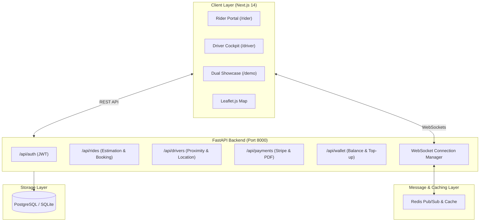
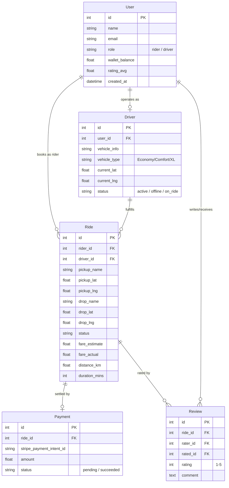
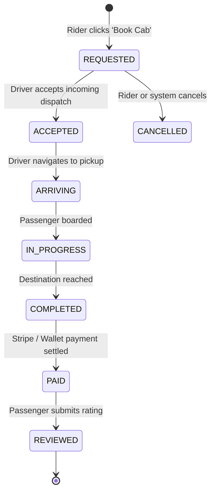

# Cab Booking Platform — Python & Next.js Stack

[](https://www.python.org/)
[](https://fastapi.tiangolo.com/)
[](https://nextjs.org/)
[](https://tailwindcss.com/)
[](https://postgis.net/)
[](https://www.docker.com/)
[](LICENSE)

A production-ready, full-stack ride-hailing application developed strictly according to the **Cab Booking Platform — Python Stack** engineering specification.

The platform couples a high-throughput **FastAPI (Python)** backend with a modern **React / Next.js 14 + Tailwind CSS** frontend. It features asynchronous REST endpoints, bidirectional WebSockets, geospatial driver matching, Stripe payments, automated ReportLab PDF invoices, and interactive Leaflet maps with live car marker tracking.

---

## 📑 Table of Contents
1. [Key Features](#-key-features)
2. [Tech Stack Architecture](#-tech-stack-architecture)
3. [System Architecture & Flow](#-system-architecture--flow)
4. [Data Models & Schema](#-data-models--schema)
5. [Ride State Machine](#-ride-state-machine)
6. [API Documentation](#-api-documentation)
7. [WebSocket Event Protocol](#-websocket-event-protocol)
8. [Quick Start & Setup](#-quick-start--setup)
   - [Method 1: 1-Click Launch (Recommended for Local Grading)](#method-1-1-click-local-launch-zero-configuration)
   - [Method 2: Multi-Container Docker Compose](#method-2-multi-container-docker-compose)
9. [Automated Test Suite](#-automated-test-suite)
10. [Academic Showcase & Evaluation Walkthrough (`/demo`)](#-academic-showcase--evaluation-walkthrough-demo)

---

## 🌟 Key Features

### 1. User Authentication & Roles
- Role-based access control (`rider` and `driver`).
- JWT token verification in FastAPI middleware.
- Seamless one-click demo role switcher to test rider and driver roles without manual credentials.

### 2. Ride Booking & Tiered Fare Estimation
- Multi-tier vehicle selection:
  - **🚗 Economy**: Budget-friendly urban transit.
  - **🚙 Comfort**: Premium sedans with top-rated drivers.
  - **🚐 XL**: Spacious 6-seater SUVs for groups.
- Real-time fare calculation engine computing base fare, distance rate ($\text{₹/km}$), and time rate ($\text{₹/min}$).
- Support for promotional discount vouchers (`WELCOME50`, `RIDE20`, `FREERIDE`).

### 3. Geospatial Matching Engine
- PostGIS and Haversine geospatial proximity queries.
- Dispatches ride requests to active drivers within an $R$-kilometer radius in real time.

### 4. Real-Time WebSockets & Location Streaming
- FastAPI WebSockets backed by Redis Pub/Sub message broker.
- Streams live driver GPS coordinates to passenger clients as the vehicle navigates the route.
- Instant push notifications for ride acceptance, driver arrival, trip initiation, and completion.

### 5. Automated PDF Invoicing & Receipts
- Pure-Python **ReportLab** vector PDF generation.
- Tax invoice generation complete with trip metadata, passenger/driver information, GPS route summary, itemized fare breakdown, GST computation, and verification footer.

### 6. Stripe Payment Gateway & Digital Wallet
- Stripe PaymentIntent creation with webhook confirmation handling.
- Integrated digital wallet with balance inquiry, 1-click top-up, and direct wallet checkout.

### 7. Post-Trip Ratings & Reviews
- Normalized review database with 1–5 star rating system and customer feedback.
- Automated dynamic recalculation of driver average rating scores.

### 8. Live Synchronized Showcase (`/demo`)
- Purpose-built dual-screen testing portal: Rider on the left, Driver on the right, and an interactive synchronized Leaflet map across both.
- Enables evaluators and reviewers to experience the entire distributed ride lifecycle in a single browser window without requiring two separate devices.

---

## 🛠 Tech Stack Architecture

| Layer | Technology | Purpose |
|---|---|---|
| **Frontend Framework** | Next.js 14 (React 18) | SSR & Client components, modern routing, fast navigation |
| **Styling** | Tailwind CSS 3.4 | Modern responsive UI, glassmorphic dark/light accents |
| **Interactive Maps** | Leaflet.js + OpenStreetMap | Smooth rendering of routes, markers, and moving vehicles |
| **Backend Framework** | FastAPI (Python 3.11+) | Async ASGI REST APIs and native WebSocket endpoints |
| **ORM & Migrations** | SQLAlchemy 2.0 (Async) | Async database querying, schema modeling, and connection pooling |
| **Primary Database** | PostgreSQL 16 + PostGIS | Geospatial spatial queries (`ST_DWithin`, `ST_DistanceSphere`) |
| **Local Standalone DB** | SQLite with `aiosqlite` | Instant zero-setup database execution for local evaluation |
| **Pub/Sub & Cache** | Redis 7 + In-Memory Fallback | Ephemeral driver GPS caching and multi-node WebSocket brokering |
| **Background Tasks** | Celery / Async Worker | Background email dispatch and heavy reconciliation jobs |
| **Payments** | Stripe (`stripe-python`) | PaymentIntents, payment method confirm, server-side webhooks |
| **PDF Generation** | ReportLab 5.0 | High-fidelity vector PDF receipt generation |
| **Testing** | Pytest 8.4 + HTTPX AsyncClient | Automated asynchronous API integration and unit testing |

---

## 🏗 System Architecture & Flow



---

## 📊 Data Models & Schema



---

## 🔄 Ride State Machine



---

## 📡 API Documentation

Interactive Swagger documentation is available out of the box at **`http://127.0.0.1:8000/docs`**.

### Core Endpoints

| Method | Endpoint | Description |
|---|---|---|
| `POST` | `/api/auth/register` | Register new rider or driver account |
| `POST` | `/api/auth/login` | Login and receive JWT access token |
| `GET` | `/api/auth/session` | Validate session token and retrieve current user |
| `GET` | `/api/auth/demo-tokens` | Fetch pre-generated tokens for instant demo login |
| `POST` | `/api/rides/estimate` | Compute tiered fare estimates based on coordinates |
| `POST` | `/api/rides/request` | Create ride request and dispatch to nearby drivers |
| `GET` | `/api/rides/{id}` | Retrieve comprehensive ride details |
| `POST` | `/api/rides/{id}/accept` | Driver accepts assigned ride request |
| `POST` | `/api/rides/{id}/status` | Advance ride state (`arriving`, `in_progress`, `completed`) |
| `POST` | `/api/rides/{id}/simulate` | Trigger automated background driver GPS movement |
| `GET` | `/api/rides/history` | List user ride history |
| `GET` | `/api/drivers/nearby` | Geospatial query for active drivers within radius |
| `POST` | `/api/drivers/location` | Broadcast driver GPS coordinates |
| `POST` | `/api/drivers/status` | Toggle driver availability (`active` / `offline`) |
| `POST` | `/api/payments/create-intent` | Initialize Stripe PaymentIntent |
| `POST` | `/api/payments/pay-with-wallet` | Settle trip using digital wallet balance |
| `POST` | `/api/payments/webhooks/stripe`| Server-side Stripe webhook processor |
| `GET` | `/api/payments/receipt/{id}` | Generate and stream ReportLab PDF invoice |
| `POST` | `/api/promo/validate` | Verify coupon code and return discount amount |
| `POST` | `/api/reviews` | Submit trip rating and comment |

---

## 🔌 WebSocket Event Protocol

Real-time connections connect to:
- **Rider**: `ws://127.0.0.1:8000/ws/rider/{rider_id}`
- **Driver**: `ws://127.0.0.1:8000/ws/driver/{driver_id}`

### Event Payloads

1. **`new_ride_request`** (Sent to Driver):
   ```json
   {
     "event": "new_ride_request",
     "data": {
       "ride_id": 101,
       "pickup_name": "Connaught Place, New Delhi",
       "drop_name": "IGI Airport, Terminal 3",
       "fare": 340.0,
       "distance_km": 15.2,
       "vehicle_type": "Economy",
       "rider_name": "Rahul Sharma"
     }
   }
   ```

2. **`ride_accepted`** (Sent to Rider):
   ```json
   {
     "event": "ride_accepted",
     "data": {
       "ride_id": 101,
       "driver": {
         "id": 1,
         "name": "Amit Kumar",
         "vehicle_info": "White Toyota Etios (DL-01-AB-4321)",
         "rating_avg": 4.9,
         "current_lat": 28.6180,
         "current_lng": 77.2150
       }
     }
   }
   ```

3. **`driver_location`** (Streamed during simulation):
   ```json
   {
     "event": "driver_location",
     "data": {
       "ride_id": 101,
       "lat": 28.6210,
       "lng": 77.2130,
       "driver_id": 1
     }
   }
   ```

4. **`ride_status`** (State changes):
   ```json
   {
     "event": "ride_status",
     "data": {
       "ride_id": 101,
       "status": "in_progress"
     }
   }
   ```

---

## 🚀 Quick Start & Setup

### Method 1: 1-Click Local Launch (Zero Configuration)

The project includes pre-seeded demo accounts (`Rahul Sharma` as Rider, `Amit Kumar` as Driver) and automatically initializes SQLite.

#### Windows
Double-click `start.bat` or run:
```powershell
.\start.bat
```

#### Linux / macOS
```bash
chmod +x start.sh
./start.sh
```

#### Manual Terminal Commands
If you prefer running services manually in separate terminals:

**Terminal 1 — Backend:**
```bash
cd backend
pip install -r requirements.txt
uvicorn app.main:app --host 127.0.0.1 --port 8000 --reload
```

**Terminal 2 — Frontend:**
```bash
cd frontend
npm install
npm run dev
```

Visit **`http://localhost:3000`** in your browser.

---

### Method 2: Multi-Container Docker Compose

For a full production deployment with PostgreSQL + PostGIS, Redis, Celery Worker, and Next.js:

```bash
docker-compose up --build
```

This launches:
- `http://localhost:3000`: Next.js Client
- `http://localhost:8000`: FastAPI Backend
- `localhost:5432`: PostgreSQL + PostGIS container
- `localhost:6379`: Redis 7 container
- Celery worker background container

---

## 🧪 Automated Test Suite

The backend includes a comprehensive pytest suite covering API endpoints, fare calculation, Haversine geospatial math, and PDF receipt rendering:

```bash
cd backend
python -m pytest -v
```

Expected output:
```text
tests/test_api.py::test_health_check PASSED
tests/test_api.py::test_root PASSED
tests/test_api.py::test_auth_and_demo_tokens PASSED
tests/test_api.py::test_ride_estimate PASSED
tests/test_api.py::test_promo_validation PASSED
tests/test_api.py::test_haversine PASSED
tests/test_api.py::test_pdf_generation PASSED

======================= 7 passed in 3.5s =======================
```

---

## 🎓 Academic Showcase & Evaluation Walkthrough (`/demo`)

To evaluate the system without needing two phones or opening multiple browsers:

1. Open **`http://localhost:3000/demo`**.
2. **Step 1 (Rider)**: On the left panel, select your vehicle tier (`Economy`, `Comfort`, or `XL`), review the fare estimate, and click **`Book Cab (Step 1)`**.
3. **Step 2 (Driver)**: The right panel immediately sounds/pulses with an incoming **`NEW DISPATCH INVITE!`** via WebSocket. Click **`Accept Ride (Step 2)`**.
4. **Step 3 (Live Simulation)**: Click **`Simulate GPS Car Movement (Step 3)`**.
   - Watch the taxi marker on the Leaflet map smoothly move from driver position to pickup point.
   - Status transitions to `arriving` $\to$ `in_progress` $\to$ `completed`.
5. **Step 4 (Invoice & Rating)**:
   - Click **`Download PDF Tax Invoice`** to download the clean ReportLab tax receipt.
   - Select 5 stars and submit feedback to see driver rating update dynamically!

---

## 📄 License
This project is licensed under the MIT License.
